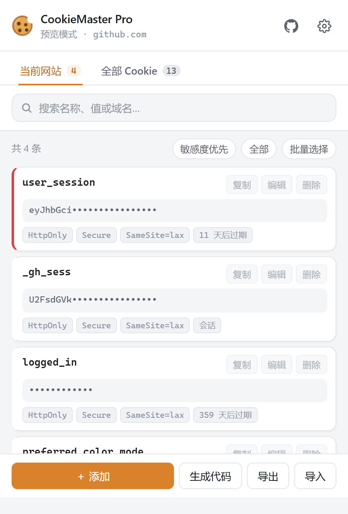
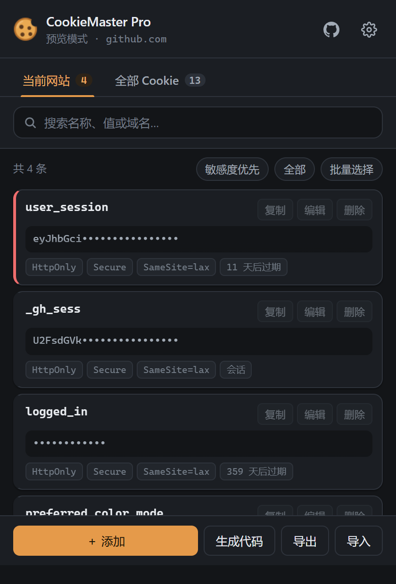
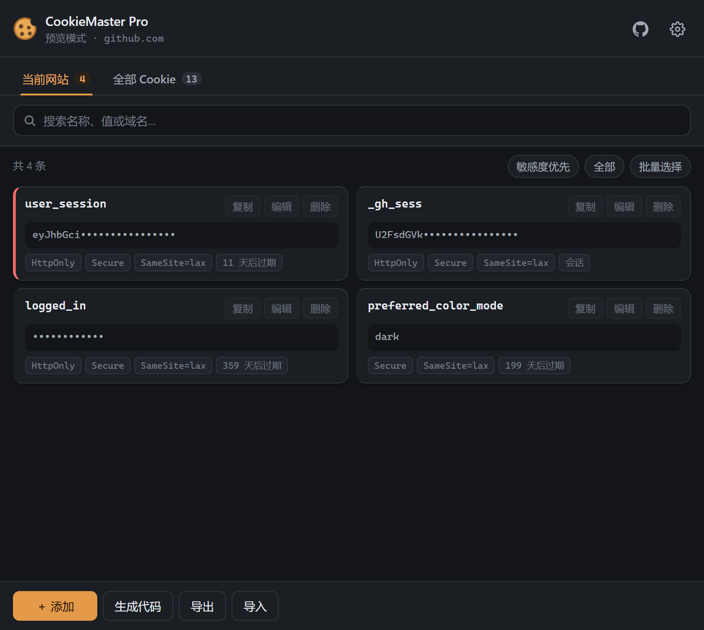
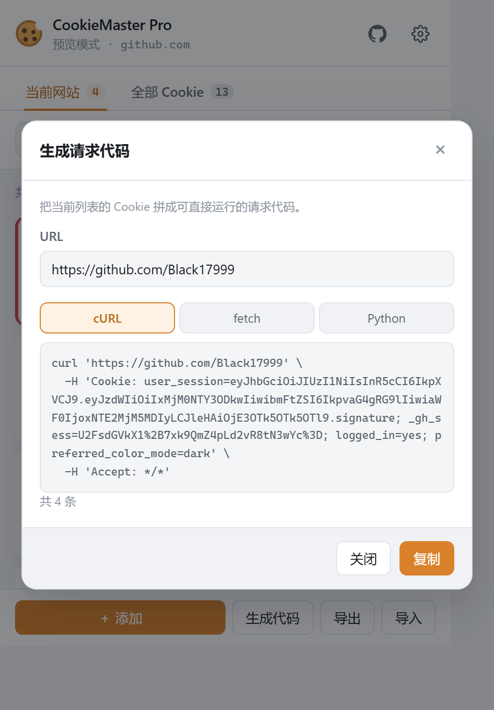
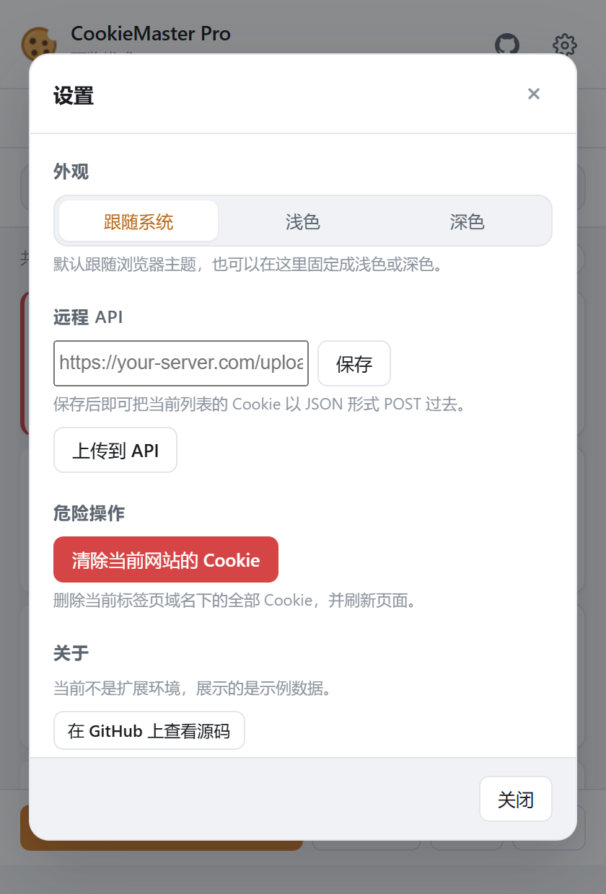
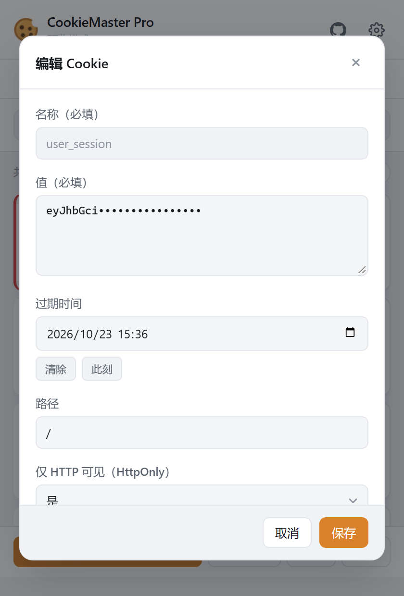

# CookieMaster Pro 🍪

[](README.md)
[](https://github.com/Black17999/Cookie-master-pro/releases)
[](https://www.google.com/chrome/)
[](https://developer.chrome.com/docs/extensions/mv3/intro/)
[](LICENSE)

A simple yet powerful cookie manager that lives in your browser's **side panel**. View, search, edit, import and export cookies from any website — with batch operations, request code generation, JWT decoding and security auditing.

---

## ✨ What's New in v3.0

| Update | Description |
| --- | --- |
| 🪟 **Side Panel** | Opens on the right of the browser, full height, persists across tab switches, freely resizable |
| 🌗 **Auto Dark Mode** | Follows your browser theme by default, or pin it to light/dark in settings |
| 🔍 **Cross-Site Search** | Search cookies from **any** website without opening it first |
| ☑️ **Batch Operations** | Multi-select to copy, export or delete in bulk |
| 💻 **Code Generation** | Turn cookies into runnable `cURL` / `fetch` / `Python requests` code |
| 🔑 **JWT Decoding** | Detects JWTs and reveals issued/expiry/subject; URL-encoded values decode in one click |
| 🛡️ **Security Audit** | Flags sensitive cookies without `Secure`, `SameSite=None` without `Secure`, over-long lifetimes and more |
| ↩️ **Undo Delete** | Restore within 6 seconds — deletions are no longer irreversible |
| 🌐 **Bilingual UI** | Interface language follows your browser (Chinese / English) |
| ⌨️ **Keyboard Control** | `↑↓` navigate, `Enter` edit, `Delete` remove, `Ctrl/Cmd+F` search |
| 🗂️ **Domain Grouping** | Collapse/expand by domain in the global view |
| 🍪 **New Icon** | Vector redrawn with a transparent background — crisp at 16px |

---

## 🌟 Key Features

### Browsing & retrieval

- **🪟 Persistent Side Panel** — Manage cookies side by side with the page
- **🔍 Global Search** — Search across every site; partial domains work too (`github` matches `github.com`)
- **🗂️ Domain Grouping** — Collapse by domain when there are many
- **🏷️ Sensitivity Detection** — Highlights session, token and auth cookies
- **📊 Attribute Badges** — HttpOnly / Secure / SameSite / expiry at a glance

### Extraction & workflow

- **💻 Code Generation** — Produces `cURL` / `fetch` / `Python requests` snippets
- **📤 Multiple Export Formats** — Header String / JSON / Netscape
- **☑️ Batch Export** — Select many, copy or export at once
- **📥 Smart Import** — Auto-detects JSON, Header String and Netscape formats
- **🌐 Remote Push** — POST cookies to a configured API

### Analysis & security

- **🔑 JWT Decoding** — Extracts issued-at, expiry, subject and the full payload
- **🔤 URL Decoding** — One-click decode of percent-encoded values
- **🛡️ Risk Audit** — Flags misconfigured sensitive cookies, with a "risky only" filter

### Editing & management

- **✏️ Full CRUD** — Create, edit and delete cookies of any domain without switching tabs
- **↩️ Undo** — Recover accidental deletions within 6 seconds
- **⚡ Live Sync** — Auto-refresh on cookie changes (deduplicated rendering, no flicker)
- **🧭 Follows the Active Tab** — In side panel mode it jumps to the new site automatically

---

## 📦 Installation

### From the Chrome Web Store (Recommended)

1. Visit the [Chrome Web Store](https://chrome.google.com/webstore)
2. Search for **CookieMaster Pro**
3. Click **Add to Chrome**

### Local Installation (Developer Mode)

1. Clone or download this repository

   ```bash
   git clone https://github.com/Black17999/Cookie-master-pro.git
   ```

2. Open Chrome and go to `chrome://extensions/`
3. Enable **Developer mode**
4. Click **Load unpacked** and select this project folder

> **Requirement**: Side panel mode requires **Chrome 114 or later**.
> On older versions the extension falls back to the classic toolbar popup.

---

## 🚀 Usage

### Opening the panel

Click the toolbar icon — the panel slides in from the **right side**. Pin it from the panel header to keep it open while switching tabs.

### Switching scope

- **Current Site** — the current tab's domain and all its subdomains
- **All Cookies** — every cookie stored in the browser

### Searching

| Input | Matches |
| --- | --- |
| `github.com` | That exact domain and its subdomains |
| `github` | Any domain containing the keyword |
| `session` | Cookies whose name or value contains it |

Results are ranked by relevance and matched text is highlighted.

### Batch operations

Click **Select** in the toolbar to enter multi-select mode:

1. Tick the rows you want, or press **Select all**
2. The bottom bar switches to **Copy** / **Export** / **Delete**
3. Press **Exit** to return to normal mode

### Code generation

Click **Code** at the bottom, pick the `cURL` / `fetch` / `Python` tab — the snippet regenerates instantly. Press **Copy** to use it.

### JWT & encoded values

Click a cookie's value to expand it. JWTs are decoded into their payload automatically; percent-encoded values get a decoded preview alongside.

### Security audit

The extension audits every cookie and flags issues such as:

- Sensitive cookie without `Secure` (can leak over plain HTTP)
- `SameSite=None` without `Secure` (browsers will reject it)
- High-privilege cookie valid over 180 days, or with no expiry
- Sensitive cookie without `HttpOnly` (readable by page scripts)

Use **Risky only** in the toolbar to show just those.

### Keyboard shortcuts

| Key | Action |
| --- | --- |
| `Ctrl / Cmd + F` | Focus search |
| `↑` `↓` | Move selection |
| `Enter` | Edit the focused cookie |
| `Delete` | Delete the focused cookie |
| `Esc` | Close dialog / exit multi-select |

### Appearance

The panel follows your browser theme by default. To pin it: ⚙️ → **Appearance** → **Auto / Light / Dark**.

### Remote API

Open ⚙️, enter and save your API URL, then push the current list to it as a JSON POST.

---

## 🖼️ Screenshots

<div style="text-align: center;">

  <figure>
    
    <figcaption>Main interface · light mode</figcaption>
  </figure>

  <figure>
    
    <figcaption>Main interface · dark mode (follows the browser)</figcaption>
  </figure>

  <figure>
    
    <figcaption>Widen the panel and it switches to a two-column layout</figcaption>
  </figure>

  <figure>
    
    <figcaption>Generate cURL / fetch / Python request code</figcaption>
  </figure>

  <figure>
    
    <figcaption>Settings · pin the appearance mode</figcaption>
  </figure>

  <figure>
    
    <figcaption>Editing a cookie</figcaption>
  </figure>

</div>

---

## 🔐 Permissions

| Permission | Purpose |
| --- | --- |
| `cookies` | Read and modify cookies |
| `tabs` | Read the active tab's URL to identify the site |
| `clipboardWrite` | Copy cookies to the clipboard |
| `storage` | Store settings such as the remote API URL |
| `sidePanel` | Display the side panel on the right of the browser |
| `<all_urls>` | Access cookies of any website (required for global search and cross-site management) |

## 🛡️ Privacy

**This extension runs entirely locally. It does not collect, upload or share any data.**

Cookie data is processed in memory only while the panel is open. Settings are stored via Chrome's official `chrome.storage.sync` in your own browser profile.

The only outbound request is the remote API you configure yourself.

See the full [Privacy Policy](PRIVACY.md).

---

## 🗂️ Project Structure

```
CookieMaster Pro/
├── manifest.json            # Extension manifest (MV3)
├── background.js            # Service worker, wires up the side panel behaviour
├── popup.html               # UI markup (shared by side panel and popup)
├── popup.js                 # UI logic (shared by side panel and popup)
├── style.css                # Stylesheet (design tokens + light/dark)
├── locales/
│   ├── zh-CN.js             # Chinese UI strings
│   └── en.js                # English UI strings
├── _locales/                # Name & description shown on the Chrome Web Store
│   ├── zh_CN/messages.json
│   └── en/messages.json
├── icon.svg                 # Icon source (vector)
├── icon-16/32/48/128.png    # Rendered icons (transparent background)
├── PRIVACY.md               # Privacy policy
└── screenshots/             # Documentation screenshots
```

> The UI files serve both the side panel and the popup — the runtime detects the host and adapts the width.

---

## 📄 License

This project is licensed under the MIT License. See the [LICENSE](LICENSE) file for details.

## 🤝 Contributing

Issues and Pull Requests are welcome!

## 📧 Contact

If you have any questions or suggestions, please submit an [Issue](https://github.com/Black17999/Cookie-master-pro/issues).
